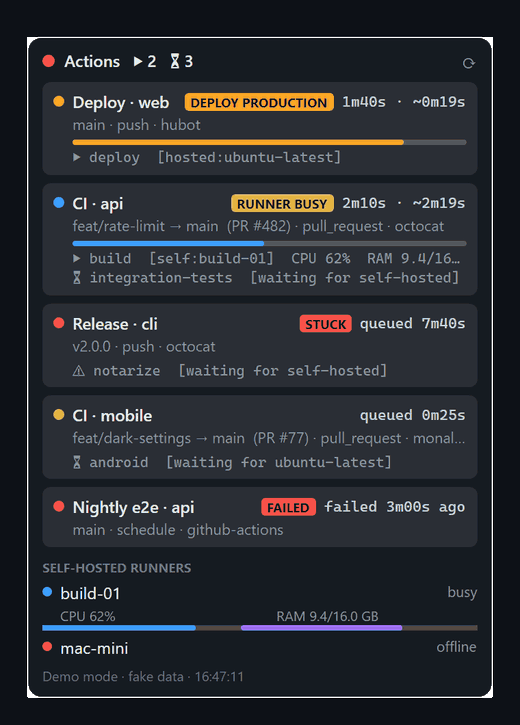

<div align="center">


# RunnerWatch

**GitHub Actions in a tiny always-on-top widget.**
See what's running, what's queued, what's *stuck*, when the deploy finishes, and how hard your self-hosted runners are working, without keeping a browser tab open.

[](https://github.com/GustavoDanielL/runnerwatch/actions/workflows/ci.yml)
[](https://github.com/GustavoDanielL/runnerwatch/releases/latest)
[](https://github.com/GustavoDanielL/runnerwatch/releases)
[](LICENSE)




<sub>Recorded with <code>RunnerWatch --demo</code> (fake data). [Português](README.pt-BR.md)</sub>

</div>

## Why

GitHub's Actions tab answers "what happened?". RunnerWatch answers **"what is happening right now, across all my repos?"**, and it knows the difference between a normal queue and a real problem:

- **RUNNER BUSY**: your self-hosted runner is working on another job. That's capacity, not an outage. No alarm.
- **STUCK**: nobody is picking the job up (runner offline, wrong labels…). You get a notification.

If you run self-hosted runners, this distinction alone saves a lot of "why is CI not starting?" detective work.

## Features

- ▶ **Running** runs with elapsed time and an **ETA** (median of the last 10 successful runs)
- ⏳ **Queue**: waiting runs, jobs waiting for a runner, and runs waiting for **environment approval**
- 🚦 **STUCK vs RUNNER BUSY**, with a notification only when it's really stuck
- 🚀 **Deploy** badge with the environment (`DEPLOY PRODUCTION`), plus a notification when a deploy finishes
- ✖ **Failed** runs stay visible for 15 min with **Re-run failed jobs** (right-click)
- 🖥 **CPU / RAM of self-hosted runners**: automatic for a runner on the same machine, or via a [tiny agent](#self-hosted-runner-metrics)
- 🔀 Branch flow (`feat/x → main (PR #7)`), event and actor
- 🔑 **Zero-setup auth**: reuses `gh`, Git Credential Manager or `GH_TOKEN` already on your machine
- 🌗 Light/dark theme and language follow the OS (English, Português; [add yours](CONTRIBUTING.md#translations))
- 🪶 Native binary (Native AOT): starts instantly, no runtime to install
- Click a run to open it · `Ctrl+Alt+G` toggles it (Windows) · draggable · translucent when idle · starts with the system

## Install

| | |
|---|---|
| **Windows** (PowerShell) | `irm https://raw.githubusercontent.com/GustavoDanielL/runnerwatch/main/install.ps1 \| iex` |
| **macOS / Linux** | `curl -fsSL https://raw.githubusercontent.com/GustavoDanielL/runnerwatch/main/install.sh \| sh` |
| **Scoop** | `scoop install https://raw.githubusercontent.com/GustavoDanielL/runnerwatch/main/packaging/scoop/runnerwatch.json` |
| **Manual** | Download your platform's archive from [Releases](https://github.com/GustavoDanielL/runnerwatch/releases/latest) (checksums in `SHA256SUMS.txt`) |

No admin rights needed. The installers verify the SHA-256 checksum before installing.

> **Unsigned builds.** RunnerWatch isn't code-signed yet. On Windows, SmartScreen may show *"Windows protected your PC"*: click **More info → Run anyway**. On macOS, use the `curl` installer: a browser download is blocked by Gatekeeper because the app isn't notarized. Every release is built by [GitHub Actions](.github/workflows/release.yml) from this repo, so you can audit exactly what you run.

**Just want to look?** Run it with fake data, no token and no network:

```bash
RunnerWatch --demo
```

## Authentication

Usually nothing to do. RunnerWatch tries, in order:

1. `GH_TOKEN` / `GITHUB_TOKEN` environment variable
2. a token you saved in the app (kept in the OS keychain: Windows Credential Manager, macOS Keychain, Linux Secret Service)
3. `gh auth token` ([GitHub CLI](https://cli.github.com/))
4. `git credential fill` (Git Credential Manager, bundled with Git for Windows): if you `git push` over HTTPS, it already works

An SSH key **does not** work: the REST API doesn't accept SSH. Run `gh auth login` once, or paste a token when asked.
Classic token: `repo` scope. Fine-grained: read access to *Actions*, *Administration* (to list runners), *Deployments* and *Metadata*; add *Actions: write* to use **Re-run**.

## Configuration

Tray icon → **Open settings…**, edit, then **Apply settings**. Every option is documented in [docs/configuration.md](docs/configuration.md). The most common ones:

```jsonc
{
  "repos": [],                 // empty = your 10 most recently pushed repos (own, org and collaborator)
  "stuckQueueMinutes": 5,
  "deployPattern": "deploy|release|publish|prod",
  "showFailuresMinutes": 15,
  "language": "auto",          // or "en", "pt-BR"
  "theme": "system"            // or "dark", "light"
}
```

GitHub Enterprise Server: set `"apiBaseUrl": "https://ghe.example.com/api/v3/"`.

## Self-hosted runner metrics

| Runner | How |
|---|---|
| GitHub-hosted (`ubuntu-latest`…) | GitHub doesn't expose metrics: you see the label only |
| Self-hosted **on the same machine** | Automatic (runner name = machine name) |
| Self-hosted **elsewhere** | Install the [agent](agent/) (Python 3, standard library only) |

```bash
sudo agent/install-linux.sh 9465 [optional-token]                               # Linux (systemd)
powershell -ExecutionPolicy Bypass -File agent\install-windows.ps1 -Port 9465   # Windows (admin)
```

RunnerWatch looks for the agent at `http://<runner-name>:9465`. Map names that don't resolve with `"agents": { "runner-name": "http://10.0.0.5:9465" }`. The agent only exposes aggregate CPU/RAM; on untrusted networks use `--token` (and `agentToken` in the config) or a VPN.

## How it works

- **Polling with ETags**, not webhooks: a desktop app has no public URL to receive webhooks, and `304 Not Modified` responses don't count against the rate limit. Idle repos are checked every 60 s, active ones every 10 s.
- **Small core**: a ~150-line REST client instead of Octokit (conditional requests out of the box, smaller native binary).
- **Native AOT**, with source-generated JSON and compiled XAML bindings: no reflection, instant start.
- Built with **.NET 10 (LTS)**, **Avalonia 12** and **CommunityToolkit.Mvvm**. See [CONTRIBUTING.md](CONTRIBUTING.md#architecture) for a map of the code.

## Limitations

- **Rate limit**: 5,000 requests/hour per token. Thanks to ETags, 10 idle repos use very little. If you hit it, the footer says when it resets.
- The latest 30 runs per repo are checked; a run queued behind 30 newer ones won't show (rare).
- Deploys are detected by name (`deployPattern`) **or** by a deployment created for the commit.
- Auto-discovered repos are the ones with recent **pushes**; a cron-only repo must be listed in `repos`.
- The global hotkey is Windows-only; on macOS/Linux use the tray/menu-bar icon. On GNOME, the tray icon needs the AppIndicator extension (preinstalled on Ubuntu).
- macOS builds are produced by CI but **haven't been tested on real Mac hardware by the maintainer yet**. Reports are very welcome!

## Roadmap

Ideas, roughly in order. 👍 the issue you want most, or pick one up:

- [ ] Multiple accounts / GitHub Enterprise and github.com at the same time
- [ ] Homebrew tap, winget, AUR and Flatpak packages
- [ ] Code signing and macOS notarization
- [ ] Filters (repo, workflow, branch) and an "only mine" toggle in the UI
- [ ] Cancel / approve runs from the widget
- [ ] More languages (es, fr, de…)

## Contributing

Contributions are very welcome, from typo fixes to new features. You don't even need a GitHub token: `--demo` gives you realistic data to work on the UI. Start with [CONTRIBUTING.md](CONTRIBUTING.md) and look for [good first issues](https://github.com/GustavoDanielL/runnerwatch/labels/good%20first%20issue).

## Uninstall

```powershell
# Windows
irm https://raw.githubusercontent.com/GustavoDanielL/runnerwatch/main/scripts/uninstall.ps1 | iex
```
```bash
# macOS / Linux  (add --purge to also delete settings, log and saved token: ... | sh -s -- --purge)
curl -fsSL https://raw.githubusercontent.com/GustavoDanielL/runnerwatch/main/scripts/uninstall.sh | sh
```

## License

[MIT](LICENSE) © Gustavo Daniel and contributors. Not affiliated with GitHub.
