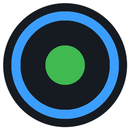
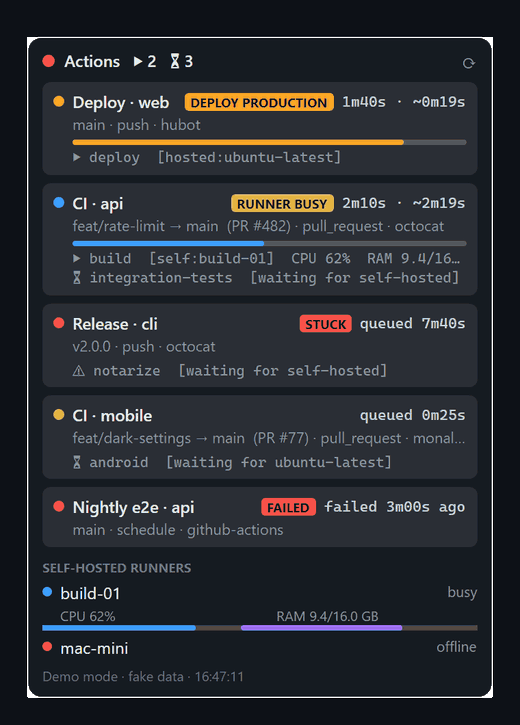

# RunnerWatch

**GitHub Actions num widget discreto, sempre visível.**
Veja o que está rodando, o que está na fila, o que está *travado*, quando o deploy termina e o quanto seus runners self-hosted estão trabalhando, sem deixar uma aba do navegador aberta.

Gravado com <code>RunnerWatch --demo</code> (dados fictícios). [English](README.md)

## Por quê

A aba Actions do GitHub responde "o que aconteceu?". O RunnerWatch responde **"o que está acontecendo agora, em todos os meus repos?"**, e sabe diferenciar fila normal de problema de verdade:

- **RUNNER OCUPADO**: o seu runner self-hosted está trabalhando em outro job. É capacidade, não pane. Sem alarme.
- **TRAVADO**: ninguém está pegando o job (runner offline, labels erradas…). Aí você recebe uma notificação.

## Recursos

- ▶ Execuções **rodando** com tempo decorrido e **previsão de término**
- ⏳ **Fila**: runs aguardando, jobs esperando runner e aprovação de *environment*
- 🚦 **TRAVADO vs RUNNER OCUPADO**, com notificação só quando trava de verdade
- 🚀 Selo de **deploy** com o ambiente (`DEPLOY PRODUCTION`) e aviso quando termina
- ✖ **Falhas** ficam visíveis por 15 min com **Re-executar jobs com falha** (botão direito)
- 🖥 **CPU/RAM dos runners self-hosted**
- 🔑 **Sem configurar nada**: usa o `gh`, o Git Credential Manager ou o `GH_TOKEN` que você já tem
- 🌗 Tema claro/escuro e idioma seguem o sistema
- 🪶 Binário nativo: abre na hora, não precisa instalar runtime

## Instalação

| | |
|---|---|
| **Windows** (PowerShell) | `irm https://raw.githubusercontent.com/GustavoDanielL/runnerwatch/main/install.ps1 \| iex` |
| **macOS / Linux** | `curl -fsSL https://raw.githubusercontent.com/GustavoDanielL/runnerwatch/main/install.sh \| sh` |
| **Scoop** | `scoop install https://raw.githubusercontent.com/GustavoDanielL/runnerwatch/main/packaging/scoop/runnerwatch.json` |

Não precisa de administrador, e os instaladores conferem o SHA-256 antes de instalar.

> **Builds sem assinatura.** No Windows, o SmartScreen pode mostrar *"O Windows protegeu o computador"*: clique em **Mais informações → Executar assim mesmo**. No Mac, use o instalador via `curl`, porque o download pelo navegador é bloqueado pelo Gatekeeper (o app ainda não é notarizado). Toda release é compilada pelo GitHub Actions a partir deste repositório.

**Só quer ver?** `RunnerWatch --demo` roda com dados fictícios, sem token e sem rede.

Autenticação, configuração, métricas dos runners e limitações estão documentadas no [README em inglês](README.md#authentication) e em [docs/configuration.md](docs/configuration.md).

## Contribuindo

Contribuições são muito bem-vindas, inclusive em português. Comece pelo [CONTRIBUTING.md](CONTRIBUTING.md). Traduzir para um idioma novo é só copiar um arquivo JSON, sem precisar de C#.

## Licença

[MIT](LICENSE) © Gustavo Daniel e contribuidores. Sem vínculo com o GitHub.
